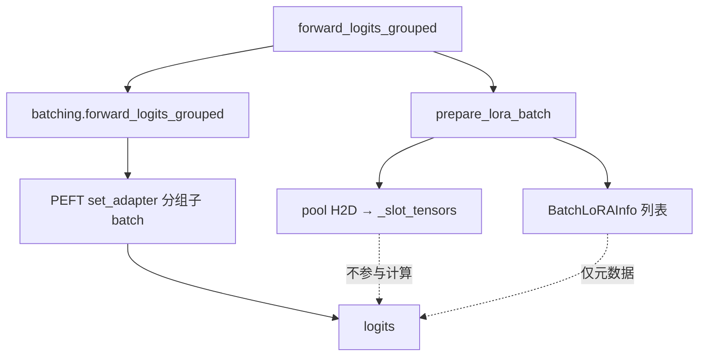
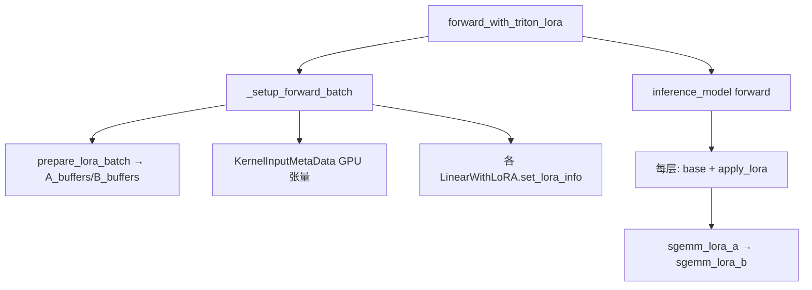

# Phase4 vs Phase3：变更总结

本文对比 `multi_lora_phase3/`（第三步快照）与 `multi_lora/`（第四步，当前主线）的实现差异，说明 Phase4 在 Phase3 基础上做了哪些修改、为何修改、以及尚未完成的部分。

---

## 1. 定位对比

| 维度 | Phase3 (`multi_lora_phase3`) | Phase4 (`multi_lora`) |
|------|------------------------------|------------------------|
| **目标** | Registry + CPU 权重库 + GPU Pool + PEFT 分组 forward | 在 Phase3 基础上接入 **整模型 Triton segment SGEMM** |
| **整模型推理** | 仅 `forward_logits_grouped` → PEFT `set_adapter` 分组 | 新增 `forward_with_triton_lora` → 模型内 `LinearWithLoRA` + kernel |
| **Pool 产出物** | `BatchLoRAInfo`（list 元数据），**不参与** PEFT 计算 | `BatchLoRAInfo` + GPU 张量版 `KernelInputMetaData`，**驱动** segment GEMM |
| **LoRA 算子** | 无 fused kernel；`layers.lora_delta` 仅单测参考 | Triton `sgemm_lora_a/b` + Torch 参考后端 |
| **依赖** | torch, transformers, peft, pytest | 同上 + **triton**（CUDA 环境） |

Phase3 的 README 已说明：第四步见 `multi_lora/`。Phase3 是**概念与数据通路**（uid → slot → weight_indices）；Phase4 是**把这条通路接到真实算子上**。

---

## 2. 目录与新增模块

### Phase3 文件（20 个）

```
multi_lora_phase3/
├── batching.py, registry.py, eviction.py, pool.py, weights.py
├── manager.py, layers.py, hf_runner.py
├── unittest/ (4)
└── examples/ (3)
```

### Phase4 新增 / 变化

| 新增路径 | 作用 |
|----------|------|
| `batch_info.py` | `KernelInputMetaData` 及 `seg_lens` / `seg_indptr` / `weight_indices` GPU 张量构造 |
| `model_utils.py` | `replace_submodule`、`get_inference_model`、`ATTENTION_LORA_SUFFIXES` |
| `backend/base.py` | `LoRABackend` 抽象：`set_kernel_input_metadata`、`run_lora_a/b_sgemm`、`apply_lora` |
| `backend/torch_backend.py` | 按 segment 分组的 PyTorch 参考实现 |
| `backend/triton_backend.py` | CUDA 上调用 Triton kernel，否则回退 Torch |
| `backend/registry.py` | `get_lora_backend("torch" \| "triton")` |
| `kernels/sgemm_lora_a.py` | Segment GEMM LoRA A |
| `kernels/sgemm_lora_b.py` | Segment GEMM LoRA B + scaling + 可选 fused add |
| `examples/inference_qwen7b_triton.py` | Qwen 整模型 batched prefill（MVP） |
| `examples/bench_phase4_linear.py` | ToyLM 整模型 forward 微基准 |
| `unittest/test_phase4_backend.py` | 整模型 Torch 后端 vs 逐行参考 |
| `unittest/test_triton_sgemm.py` | Triton vs Torch 整模型（需 CUDA） |

Phase3 中 **未改包名** 的模块（`batching.py`、`registry.py`、`eviction.py`、`weights.py`、`hf_runner.py`）在 Phase4 中逻辑基本保留，仅 import 路径变为 `multi_lora.*`。

---

## 3. 核心架构变化

### 3.1 Phase3 数据流（主路径）



要点：`prepare_lora_batch` **暖 pool**，但 logits **仍由 PEFT 内部 LoRA 计算**；GPU pool 权重与 forward **脱节**。

### 3.2 Phase4 数据流（Triton 热路径）



要点：LoRA 增量在 **模型图内部** 完成；PEFT `LoraLayer` 被替换为 `LinearWithLoRA`；`BatchLoRAInfo` 升级为 GPU 版 `KernelInputMetaData` 并绑定到 backend。

---

## 4. 分模块 diff

### 4.1 `manager.py`

| 能力 | Phase3 | Phase4 |
|------|--------|--------|
| `from_pretrained` 参数 | 无 backend / convert 选项 | `lora_backend`、`lora_target_suffixes`、`convert_lora_layers` |
| 成员 | `model`, `pool`, `registry`, `_weight_store` | + `_lora_backend`, `inference_model`, `lora_wrappers` |
| 主 forward | 仅 `forward_logits_grouped` | + `forward_with_triton_lora`、`_setup_forward_batch` |
| 模型手术 | 无 | `convert_to_lora_layers()`：PEFT `LoraLayer` → `LinearWithLoRA` |
| PEFT golden | 唯一推理路径 | 保留 `forward_logits_grouped` 作数值对照 |

**Phase4 新增关键 API：**

```python
mgr = MultiLoRAManager.from_pretrained(
    base,
    adapters,
    lora_backend="triton",
    lora_target_suffixes=ATTENTION_LORA_SUFFIXES,  # MVP: q/k/v/o_proj；None=全部
    convert_lora_layers=True,
)

out = mgr.forward_with_triton_lora(
    input_ids=..., attention_mask=..., lora_ids=ids,
)
```

**混合路径说明（MVP）：**

- 默认只替换 attention 四投影（`q_proj`, `k_proj`, `v_proj`, `o_proj`）。
- 未替换的模块（如 MLP）若仍为 PEFT `LoraLayer`，forward 时会 **条件性** `disable_adapter()`，避免与 Triton 双算；此时 MLP LoRA **不会生效**。
- 要与 PEFT 全模型 logits 一致，需 `lora_target_suffixes=None`（替换 weight store 中全部模块）。

### 4.2 `pool.py`（重要重构）

| 项目 | Phase3 | Phase4 |
|------|--------|--------|
| 权重存储 | `_slot_tensors[slot_id][module_key] = (A, B)` 每槽独立 dict | `A_buffers[module_key][slot_id]` / `B_buffers[module_key][slot_id]` **堆叠** |
| 形状（单模块） | 每槽 `A: [max_rank, in]`, `B: [out, max_rank]` | 堆叠后 `A: [K, max_rank, in]`, `B: [K, out, max_rank]` |
| 预分配 | 在 `_load_uid_to_slot` 里 per-slot 临时 `torch.zeros` | `finalize_buffers()` 按 module_key **一次性**预分配 |
| Kernel 读权重 | 无 kernel 路径 | `get_module_buffers(module_key)` **直接**返回堆叠张量 |
| 驱逐 | 删除 `_slot_tensors[victim_slot]` | 仅清除 uid 映射；堆叠 buffer 行由下次 H2D 覆盖 |
| 删除的能力 | — | 无 `stack_module_weights()`（曾用于单层临时 stack，已移除） |

设计动机：避免每个 forward、每个 module 做 `zeros + copy_` 的 stack 开销。

### 4.3 `layers.py`

| Phase3 | Phase4 |
|--------|--------|
| `lora_delta()` 函数 | 保留（单测参考） |
| `forward_linear_with_pool_lora()` 手动单层 | **删除** |
| — | 新增 `LinearWithLoRA`：`base(x)` + `backend.apply_lora(x, A, B, y_base)` |

`LinearWithLoRA` 在 `convert_to_lora_layers` 中 **替换** 推理模型内的 PEFT `LoraLayer`，成为整模型 Triton 的挂载点。

### 4.4 新增 `batch_info.py`

Phase3 只有 list 版 `BatchLoRAInfo`（`weight_indices: List[int]` 等）。

Phase4 新增 GPU 张量版 `KernelInputMetaData`：

- `seg_lens` / `seg_indptr`：支持 decode（每行 1 token）与 prefill（每序列多 token）
- `weight_indices`：每个 segment 选 pool slot
- `lora_ranks` / `scalings`：按 slot 索引

由 `build_kernel_input_metadata(lora_ids, seq_lens=...)` 构造，供 Triton kernel 消费。

### 4.5 新增 `backend/` + `kernels/`

| 组件 | 说明 |
|------|------|
| `LoRABackend` | 统一接口；`set_kernel_input_metadata` 一次 per forward |
| `TorchLoRABackend` | 按 segment 循环 matmul，数值 golden |
| `TritonLoRABackend` | 调用 `sgemm_lora_a_fwd` / `sgemm_lora_b_fwd`；B 支持 `base_output` fused add |
| `sgemm_lora_a/b` | Segment batched LoRA GEMM；`weight_indices[batch_id]` 选 adapter |

---

## 5. 推理路径对比

### 5.1 整模型 prefill / decode

| 场景 | Phase3 | Phase4 |
|------|--------|--------|
| Batched prefill logits | `forward_logits_grouped` | `forward_with_triton_lora`（Triton）或 grouped（golden） |
| 串行 `generate` | `inference_qwen7b_lora.py` → PEFT `generate` | 同左（**未改** generate 循环） |
| Pool 调用频率 | 每次 grouped forward 前 1 次 | Triton 路径：每次 forward 前 1 次 `_setup_forward_batch` |
| Multi-LoRA 计算位置 | PEFT 内部 | 已 convert 的 `LinearWithLoRA` 内部 |

### 5.2 示例脚本

| Phase3 | Phase4 |
|--------|--------|
| `smoke_phase3_manager.py` | 保留（仍测 pool + grouped） |
| `inference_qwen7b_lora.py` | 保留（PEFT generate） |
| — | `inference_qwen7b_triton.py`（整模型 Triton prefill MVP） |
| — | `bench_phase4_linear.py`（ToyLM 整模型 benchmark） |

已删除：`inference_qwen7b_triton_linear.py`（单层 hook + `forward_linear_with_pool_backend`）。

---

## 6. 测试对比

| 测试 | Phase3 | Phase4 |
|------|--------|--------|
| `test_pool.py` | 驱逐 / slot 映射 | 同逻辑（pool API 兼容 `get_slot_weights`） |
| `test_manager_phase3.py` | grouped vs rowwise | 同；fixture 加 `convert_lora_layers=False` 以免破坏 PEFT |
| `test_batching.py` / `test_registry.py` | 有 | 有（未变） |
| `test_phase4_backend.py` | — | 整模型 Torch vs 逐行参考 |
| `test_triton_sgemm.py` | — | Triton vs Torch 整模型（CUDA） |

`pytest multi_lora/unittest/ -q` → **14 passed**。

---

## 7. Phase3 保留 unchanged 的部分

以下在 Phase4 中 **语义不变**，可直接对照 Phase3 文档：

- `registry.py`：`LoRARef`、`acquire` / `release`、`pinned`
- `eviction.py`：LRU / FIFO 驱逐
- `weights.py`：`extract_adapter_weights` → CPU `AdapterWeights`
- `batching.py`：分组 PEFT forward、`validate_lora_batch`
- `prepare_lora_batch` / `build_batch_info` 的 **batch 级**语义（distinct uid → slot → per-row `weight_indices`）

Phase4 的 pool 重构 **不改变** 上述调度语义，只改变 GPU 权重的 **物理布局** 与 **消费方式**。

---

## 8. Phase4 MVP 边界（当前未做）

| 项 | 状态 |
|----|------|
| 整模型 `generate` 走 Triton | 已做                                     |
| MLP LoRA Triton（gate/up/down） | 未默认接入（仅 attention 四投影） |
| qkv / gate_up 权重合并与专用 kernel | 未做 |
| CUDA Graph + in-place `KernelInputMetaData` | 未做 |
| 异步 H2D / overlap | 未做 |
| 与 PEFT 全模型 logits 一致（默认 MVP） | 需 `--all-lora-modules` 替换全部 LoRA 层 |

---

## 9. 迁移指引（Phase3 → Phase4）

**若只需 pool + PEFT grouped（与 Phase3 等价）：**

```python
mgr = MultiLoRAManager.from_pretrained(..., convert_lora_layers=False)
logits, info = mgr.forward_logits_grouped(...)
```

**若要走 Triton 整模型（MVP）：**

```python
from multi_lora.manager import MultiLoRAManager, ATTENTION_LORA_SUFFIXES

mgr = MultiLoRAManager.from_pretrained(
    base, adapters,
    lora_backend="triton",
    lora_target_suffixes=ATTENTION_LORA_SUFFIXES,
)
out = mgr.forward_with_triton_lora(input_ids=..., attention_mask=..., lora_ids=ids)
```

**若需与 PEFT grouped 全模型对齐：**

```python
mgr = MultiLoRAManager.from_pretrained(
    base, adapters,
    lora_backend="triton",
    lora_target_suffixes=None,  # 替换全部 LoRA 模块
)
# 对比 mgr.forward_logits_grouped(...) 与 forward_with_triton_lora(...)
```

---

## 10. 一句话总结

**Phase3** 完成了 multi-LoRA 的 **注册表 + CPU/GPU 权重池 + batch 元数据**，推理仍靠 **PEFT 分组 forward**，pool 与计算分离。

**Phase4** 在 Phase3 数据通路上接入 **segment SGEMM**：重构 pool 为堆叠 buffer、新增 `KernelInputMetaData` 与 Triton/Torch 后端、用 `LinearWithLoRA` 替换目标层，提供 **`forward_with_triton_lora` 整模型入口**；PEFT grouped 保留为 golden，MVP 默认只加速 attention 四投影。
