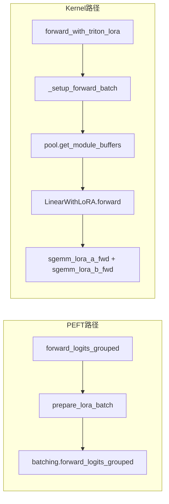

# Multi-LoRA(分阶段实现)

本目录实现 **multi-LoRA serving phase4**;同一服务进程内为不同请求绑定不同 LoRA adapter,并支持分组 batch 前向推理、GPU 权重池与整模型 Triton segment GEMM(MVP;attention四个linear模块)。

**历史快照**(各阶段可独立运行,包名不同);

| 目录 | 阶段 |
|------|------|
| `multi_lora_phase1/` | 第一步;HF + PEFT 串行推理 |
| `multi_lora_phase2/` | 第二步;+ 分组 batch forward |
| `multi_lora_phase3/` | 第三步;+ registry / pool / manager |
| `multi_lora/`(本目录) | 第四步;+ KernelInputMetaData、Torch/Triton SGEMM |

各阶段 **函数调用栈** 详见对应目录 README;`multi_lora_phase1/README.md` … `multi_lora_phase3/README.md`;下文为 **本目录(phase4)** 工作流。

---

## 工作流与函数调用栈(Phase 4)

Phase4 = Phase3 全部能力 **+** `KernelInputMetaData`、可插拔 `LoRABackend`、整模型 ``LinearWithLoRA`` + ``forward_with_triton_lora``。PEFT 分组 forward 仍作 golden;Triton 热路径在模型内各层自动调用 segment GEMM。



### A)整模型 logits(与 phase3 相同,主路径)

```
MultiLoRAManager.forward_logits_grouped(...)
├── prepare_lora_batch(lora_ids)              # 同 phase3;pool H2D + BatchLoRAInfo
├── peft_name_for_row(uid) → PEFT adapter 名
└── batching.forward_logits_grouped(PeftModel, ..., lora_ids=peft_keys)
```

`examples/smoke_phase3_manager.py`、`inference_qwen7b_lora.py --batched-prefill` 均走此栈。

---

### B)端到端生成;`examples/inference_qwen7b_lora.py`(不经过 Triton)

```
main()
├── MultiLoRAManager.from_pretrained(..., lora_backend="torch")   # 生成不用 kernel
└── for each request:
    └── run_one_request(...)
        ├── registry.acquire(adapter_name) → lora_id
        ├── prepare_lora_batch([lora_id])                         # 暖 pool
        ├── peft_name_for_row(lora_id)
        ├── generate_with_peft → model.set_adapter / disable_adapter
        │   └── hf_runner.generate_text → model.generate(...)
        └── registry.release(lora_id)
```

**说明**;串行 ``generate`` 示例仍走 PEFT;整模型 Triton 见 ``forward_with_triton_lora`` 与 ``examples/inference_qwen7b_triton.py``。

---

### C)整模型 Triton;`forward_with_triton_lora`(MVP)

```
MultiLoRAManager.from_pretrained(..., lora_backend="triton", lora_target_suffixes=ATTENTION_LORA_SUFFIXES)
├── convert_to_lora_layers()   # LoraLayer → LinearWithLoRA(默认 q/k/v/o_proj)
└── forward_with_triton_lora(input_ids, attention_mask, lora_ids)
    ├── _setup_forward_batch(lora_ids)     # batch 级 prepare + KernelInputMetaData
    │   └── 各 wrapper.set_lora_info(pool.get_module_buffers(module_key))
    ├── model.disable_adapter()            # 避免 PEFT 与 Triton 双算
    └── inference_model(...)               # 每层 LinearWithLoRA: base + sgemm_a/b
```

``examples/bench_phase4_linear.py``、``unittest/test_phase4_backend.py`` 用 ToyLM 验证;``--all-lora-modules`` 可替换全部 LoRA 并与 PEFT grouped 对比。

---

### D)Qwen + Triton 整模型 prefill;`examples/inference_qwen7b_triton.py`

```
main()
├── MultiLoRAManager.from_pretrained(..., lora_backend="triton", lora_target_suffixes=qkv o)
└── forward_with_triton_lora(input_ids, attention_mask, lora_ids)   # batched prefill
```

---

### F)后端工厂与注册

```
get_lora_backend("torch" | "triton")     # backend/registry.py
├── "torch"  → TorchLoRABackend
└── "triton" → TritonLoRABackend
```

`MultiLoRAManager.__init__(..., lora_backend=...)` 时绑定到 `self._lora_backend`。

---

### G)单测速查

| 文件 | 主调用链 |
|------|----------|
| `test_batching.py` | phase2 grouped vs rowwise |
| `test_registry.py` / `test_pool.py` | phase3 |
| `test_manager_phase3.py` | manager + grouped vs rowwise |
| `test_phase4_backend.py` | `forward_with_triton_lora` + ToyLM |
| `test_triton_sgemm.py` | triton vs torch 整模型 forward |

---

## 设计边界

- **模型与前向**;优先使用 **Hugging Face Transformers** 与 **PEFT** 完成加载、前向与正确性对照。
- **本包能力**;`LoRARef` / 注册表、`max_loras_per_batch`、GPU 槽位池、驱逐策略、按 batch 的 segment GEMM(Triton)等。
- **triton kernel支持范围**;generate / forward_logits_grouped 主路径仍走 PEFT默认实现;forward_with_triton_lora 可做整模型 forward/prefill,但 Triton 热路径的粒度仍限于被替换的 LoRA Linear 层,默认 Qwen 仅覆盖 q/k/v/o_proj,--all-lora-modules 可覆盖全部 LoRA Linear 模块

---
## 使用模型与独立安装运行

本目录(phase4)是一个自包含的 Python 包,**不依赖** `multi_lora_phase1/2/3`(三者只是历史快照),可单独安装运行。

| 角色 | Hugging Face ID |
|------|-----------------|
| 基座 | `Qwen/Qwen2-7B-Instruct` |
| LoRA 1 | `FuturisticVibes/Qwen2-7B-TestInstructFinetune-LORA`(rank=32,标准 attention/MLP LoRA) |
| LoRA 2(串行切换) | `Bibaolong/Context-Faithful-Qwen2-7B-Instruct`(基于 Instruct,rank=64) |

### 1)环境要求

| 项 | 说明 |
|----|------|
| Python | ≥ 3.9 |
| 依赖 | `torch` / `transformers` / `peft` / `accelerate` / `pytest` / `triton`(见 `requirements.txt`;Windows 不装 triton) |
| GPU | Triton 路径 **必须** CUDA;无卡时 `TritonLoRABackend` 回退 Torch 实现,`test_triton_sgemm.py` 自动 skip。Qwen2-7B bf16 全量约 16GB,`--low-vram` 压到 9GiB + CPU offload |
| 磁盘 / 网络 | 单测用 tiny-gpt2 / ToyLM(数 MB 或纯本地);Qwen 示例需约 15GB 权重 + 两个 LoRA |

### 2)安装

```bash
# 进入仓库根目录,即包含 multi_lora/ 的那一层
cd /path/to/multi_lora

python -m venv .venv-phase4
source .venv-phase4/bin/activate
pip install -U pip
pip install -r multi_lora/requirements.txt
```

推荐直接使用容器镜像 `nvcr.io/nvidia/pytorch:25.04-py3`(torch + triton 已内置,版本匹配,见 `setup.txt`),只需补装 `transformers/peft/accelerate/pytest`。用 PyPI 默认 wheel 时请确认 torch 与 triton 版本互相匹配,否则 kernel 编译会失败。

### 3)运行前置

包内均为绝对导入(`import multi_lora.xxx`),需把 **仓库根目录** 加入导入路径;

```bash
cd /path/to/multi_lora
export PYTHONPATH=$(pwd)
export CUDA_VISIBLE_DEVICES=0

# 可选;模型缓存位置与下载加速
export HF_HOME=/data/hf
export HF_ENDPOINT=https://hf-mirror.com
```

### 4)跑单测(最快验证)

```bash
python -m pytest multi_lora/unittest/ -q                     # 全部;无 CUDA 时 triton 用例自动 skip
python -m pytest multi_lora/unittest/test_phase4_backend.py -q   # ToyLM 上 forward_with_triton_lora
python -m pytest multi_lora/unittest/test_triton_sgemm.py -q     # 需 CUDA;triton vs torch 整模型
```

### 5)跑示例

```bash
# 串行单 adapter 冒烟(跳过基座可省一次全量加载)
python multi_lora/examples/smoke_single_adapter.py
python multi_lora/examples/smoke_single_adapter.py --skip-base --low-vram --gpu-id 1

# 一次加载基座 + 两个 LoRA,按请求切换 adapter 生成(推荐端到端示例)
python multi_lora/examples/inference_qwen7b_lora.py
python multi_lora/examples/inference_qwen7b_lora.py --low-vram --gpu-id 0 --max-new-tokens 64
python multi_lora/examples/inference_qwen7b_lora.py --batched-prefill   # 额外跑一轮分组 prefill

# 整模型 Triton prefill(MVP;attention 四投影;需 CUDA + triton)
python multi_lora/examples/inference_qwen7b_triton.py
python multi_lora/examples/inference_qwen7b_triton.py --low-vram --gpu-id 0
python multi_lora/examples/inference_qwen7b_triton.py --all-lora-modules --compare-peft

# ToyLM 微基准;整模型 forward_with_triton_lora vs 逐行 lora_delta 参考(不下载大模型)
python multi_lora/examples/bench_phase4_linear.py --batch 64 --iters 200

# phase3 manager 主路径与分组 forward 冒烟
python multi_lora/examples/smoke_phase3_manager.py --low-vram --gpu-id 0
python multi_lora/examples/smoke_multi_lora_batch.py --low-vram --gpu-id 0 --lora-ids "a,"
```

- `inference_qwen7b_lora.py` 另有 `--max-new-tokens`、`--temperature`、`--device {auto,cuda,cpu}`、`--batched-prefill`。
- `inference_qwen7b_triton.py` 另有 `--all-lora-modules`(替换全部 LoRA Linear,而非默认仅 q/k/v/o_proj)与 `--compare-peft`(与 PEFT 分组 forward 对比 logits,需配合前者);该脚本只做 prefill,没有生成类参数。

### 6)当库调用

```python
from multi_lora.manager import MultiLoRAManager, ATTENTION_LORA_SUFFIXES

mgr = MultiLoRAManager.from_pretrained(
    base, adapters, lora_backend="triton", lora_target_suffixes=ATTENTION_LORA_SUFFIXES
)
out = mgr.forward_with_triton_lora(input_ids=..., attention_mask=..., lora_ids=ids)
```

`lora_backend` 传 `"torch"` 即走参考实现(无需 CUDA),两者可直接对比数值。

---
# multi lora四阶段简介
## 第一步;能跑起来(最小可运行 / 正确性基线)✅

**目标**;不追求单 batch 多 LoRA 性能,只验证 **基座 + 多个已加载 LoRA** 在本地可推理、输出合理。

已实现;

1. **`requirements.txt`**;`torch`、`transformers`、`peft`、`accelerate`
2. **`hf_runner.py`**;加载基座 / PEFT、生成、`--low-vram` 时 CPU offload
3. **`examples/smoke_single_adapter.py`**;基座可选 + 两个 LoRA **串行**加载生成

**验收**;一条命令在标准 HF + PEFT 依赖下跑通;可与官方 Peft 用法对照。

---

## 第二步;单进程 伪 multi-LoRA——同一逻辑 batch、不同序列不同 adapter(仍可用纯 PyTorch)✅

**目标**;在 **一个** `forward` 调用语义下(或一次 `generate` 批处理),让 **不同序列** 绑定 **不同 `lora_id`**,先 **不** 引入 GPU 权重池与 fused kernel。

已实现(**路径 A;按 adapter 分组子 batch**);
- **路径 A**;小 batch 时按 adapter **分组** 子 batch,对每组调用带对应 LoRA 的 forward,再在 batch 维拼回(实现简单,用于对齐 logits 形状与调度逻辑)。
- **路径 B**;自定义 `nn.Module` 包装若干线性层,对 `lora_id` 做 **Python 索引** 选择当前 token/行对应的 A/B(先限制 rank 一致或小 batch),验证 **数值与分组 forward 一致**。)

1. **`batching.py`**
   - `group_row_indices` / `validate_lora_batch`(限制单 batch 内 distinct LoRA 数量)
   - `load_peft_multi_adapter`;一个基座 + `load_adapter` 挂多个 checkpoint
   - `forward_logits_grouped`;按行 `lora_id` 分组前向,共享同一lora id的行组成一个batch来推理, 只用基座模型的也组成一个batch来推理,`index_copy_` 拼回 `[B,T,V]`
   - `forward_logits_rowwise_reference`;naive实现,逐行 `bs=1` 前向,作为数值参考
2. **`unittest/test_batching.py`**;`sshleifer/tiny-gpt2` 上自造两个 LoRA,断言 grouped 与 rowwise `allclose`
3. **`examples/smoke_multi_lora_batch.py`**;Qwen2-7B + 两个 HF LoRA,对比 grouped vs rowwise logits(低显存加 `--low-vram`)

容器内示例;

```bash
cd /Path/to/multi_lora
python -m pytest multi_lora/unittest/test_batching.py -q
python multi_lora/examples/smoke_multi_lora_batch.py --low-vram --gpu-id 0 --lora-ids "a,"
```

**验收**;分组前向与逐行参考在 `rtol/atol` 内一致(因果 LM 行独立时与 路径 B 等价验证可后续加)。

---

## 第三步;Registry、槽位上限、显存池与驱逐 ✅

**目标**;引入注册表、CPU 权重库、GPU 槽位池与驱逐;推理仍走 PEFT 分组 forward,GPU pool 为第四步 kernel 准备数据。

| 概念 | 本目录模块 |
|------|------------|
| `LoRARef` / 注册表 | `registry.py` |
| `max_loras_per_batch` | `batching.validate_lora_batch` / `manager.validate_lora_batch` |
| GPU 槽位(uid→slot、rank/scale) | `pool.py` |
| LRU / FIFO 驱逐 | `eviction.py` |
| 编排与 `prepare_lora_batch` | `manager.py` |
| 朴素 LoRA delta | `layers.py` |
| CPU 权重抽取 | `weights.py` |

**用法概要**;

```python
mgr = MultiLoRAManager.from_pretrained(base, {"a": path_a, "b": path_b}, max_loras_per_batch=2)
lora_ids = [mgr._peft_name_to_id["a"], None]  # 或用 registry.acquire(["a", None])
logits, info = mgr.forward_logits_grouped(input_ids=..., attention_mask=..., lora_ids=lora_ids)
# info.weight_indices / info.lora_ranks / info.scalings 供 KernelInputMetaData 使用
```

容器内;

```bash
python -m pytest multi_lora/unittest/ -q
python multi_lora/examples/smoke_phase3_manager.py --low-vram --gpu-id 0
```

**验收**;pytest 覆盖 registry、pool 驱逐、`MultiLoRAManager` 与第二步 rowwise 一致;smoke 可打印 `pool_total_evictions`。

---

## 第四步;KernelInputMetaData + Triton segment SGEMM(单层)✅

**实现选择**;``pool`` + ``KernelInputMetaData`` 与 **segment GEMM**(``sgemm_lora_a/b``)配合,按段选择槽位并计算 LoRA delta;

| 组件 | 路径 |
|------|------|
| ``KernelInputMetaData`` | ``batch_info.py`` |
| Triton kernels | ``kernels/sgemm_lora_a.py``, ``kernels/sgemm_lora_b.py`` |
| ``TritonLoRABackend`` | ``backend/triton_backend.py``;CUDA 上 ``sgemm`` A→B;CPU 回退 Torch |
| 参考实现 | ``backend/torch_backend.py`` |
| 入口 | ``manager.forward_with_triton_lora(..., lora_backend="triton")`` |

**用法**(整模型 prefill;默认仅 ``q/k/v/o_proj``);

```python
from multi_lora.manager import MultiLoRAManager, ATTENTION_LORA_SUFFIXES

mgr = MultiLoRAManager.from_pretrained(
    base, adapters, lora_backend="triton", lora_target_suffixes=ATTENTION_LORA_SUFFIXES
)
out = mgr.forward_with_triton_lora(input_ids=..., attention_mask=..., lora_ids=ids)
```

**测试**;

```bash
pytest multi_lora/unittest/ -q
pytest multi_lora/unittest/test_triton_sgemm.py -q   # 需 CUDA
```

## 实现顺序小结

| 步 | 焦点 | 主要依赖 |
|----|------|----------|
| 1 | 跑通 HF + PEFT,单 adapter 串行多 adapter | Transformers, PEFT |
| 2 | 多序列多 adapter 正确性(分组或朴素索引) | PyTorch |
| 3 | Registry + pool + 驱逐 + validate | PyTorch |
| 4 | KernelInputMetaData + Torch/Triton SGEMM;整模型 ``forward_with_triton_lora`` | PyTorch + Triton |
