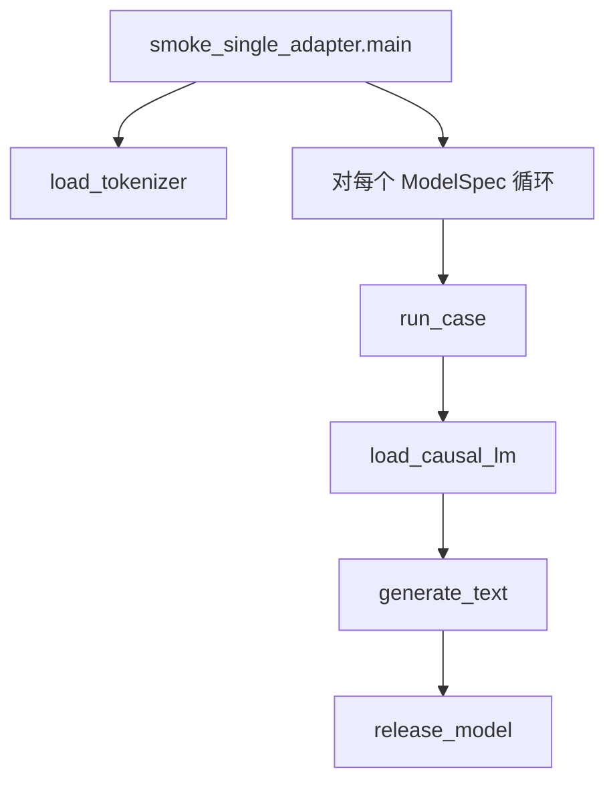

# multi_lora_phase1（第一步快照）

**目标**：基座 + 多个 PEFT LoRA **串行**推理，无 multi-LoRA batch、无 GPU pool。

| 文件 | 说明 |
|------|------|
| `hf_runner.py` | 加载基座/PEFT、生成、`--low-vram` |
| `examples/smoke_single_adapter.py` | Qwen2-7B + 两个 LoRA 串行 smoke |

完整演进见 `multi_lora/`（第四步）、`multi_lora_phase2`、`multi_lora_phase3`。

---

## 独立安装与运行

本目录是一个自包含的 Python 包，**不依赖** `multi_lora_phase2/3` 与 `multi_lora/`，可单独安装运行。

### 1）环境要求

| 项 | 说明 |
|----|------|
| Python | ≥ 3.9 |
| 依赖 | `torch` / `transformers` / `peft` / `accelerate`（见 `requirements.txt`，本阶段无 pytest、无 triton） |
| GPU | 非必需。Qwen2-7B bf16 全量约需 16GB 显存；`--low-vram` 把 GPU 上限压到 9GiB 其余 offload 到 CPU；`--device cpu` 可无卡运行但极慢 |
| 磁盘 / 网络 | 需从 Hugging Face 拉取 Qwen2-7B-Instruct（约 15GB）与两个 LoRA |

### 2）安装

```bash
# 进入仓库根目录，即包含 multi_lora_phase1/ 的那一层
cd /path/to/multi_lora

python -m venv .venv-phase1
source .venv-phase1/bin/activate
pip install -U pip
pip install -r multi_lora_phase1/requirements.txt
```

`requirements.txt` 装的是默认 PyPI 的 torch wheel。需要指定 CUDA 版本时，先按 PyTorch 官方 index 装 torch，再装其余三个包；或直接使用容器镜像 `nvcr.io/nvidia/pytorch:25.04-py3`（torch 已内置，只需补 `transformers/peft/accelerate`）。

### 3）运行前置

示例脚本以 **仓库根目录** 为导入根（`import multi_lora_phase1.xxx`），脚本内的 `sys.path` 自举不覆盖这一层，因此需显式设置：

```bash
cd /path/to/multi_lora
export PYTHONPATH=$(pwd)

# 可选：模型缓存位置与下载加速
export HF_HOME=/data/hf
export HF_ENDPOINT=https://hf-mirror.com
```

### 4）运行

```bash
# 默认：base → lora-1 → lora-2 串行各生成一次
python multi_lora_phase1/examples/smoke_single_adapter.py

# 显存紧张（约 10GB 空闲）：跳过纯基座那一轮 + CPU offload，并指定 GPU
python multi_lora_phase1/examples/smoke_single_adapter.py --skip-base --low-vram --gpu-id 1

# 只跑一个 LoRA（第二个置空即可跳过）
python multi_lora_phase1/examples/smoke_single_adapter.py --lora-2 "" --max-new-tokens 16

# 无 GPU 环境（7B 在 CPU 上极慢，仅作跑通验证）
python multi_lora_phase1/examples/smoke_single_adapter.py --device cpu --max-new-tokens 4 --lora-2 ""
```

想换成小基座压测流程时，`--base-model` 与 `--lora-1` 必须成对替换成匹配的一组，否则 `PeftModel.from_pretrained` 会因目标模块对不上而报错。

常用参数：`--base-model` / `--lora-1` / `--lora-2`（HF id 或本地路径）、`--prompt`、`--max-new-tokens`、`--temperature`（`0` 为贪心）、`--skip-base`、`--low-vram`、`--gpu-id`、`--device {auto,cuda,cpu}`。

**预期输出**：每个用例打印一段 `=== [label] device=... ===` 头与生成文本，全部跑完输出 `OK: all cases finished.`。本阶段无单测。

---

## 工作流总览

本阶段只有一条主路径：**每个 adapter 单独加载模型 → 生成 → 释放**。同一进程内不会把多 adapter 放进一个 batch forward。



---

## 函数调用栈

### 1）Smoke 入口：`examples/smoke_single_adapter.py`

```
main()
├── load_tokenizer(base_model)
│   └── AutoTokenizer.from_pretrained(...)
└── for spec in cases:                    # base → lora-1 → lora-2（串行，非同一 batch）
    └── run_case(spec, ...)
        ├── pick_device() / pick_dtype()
        ├── load_causal_lm(base_model, lora_path=spec.lora_path, low_vram=...)
        │   ├── AutoModelForCausalLM.from_pretrained(...)     # 基座
        │   └── [若 lora_path] PeftModel.from_pretrained(base, lora_path)   # 单 adapter
        ├── generate_text(model, tokenizer, prompt, ...)
        │   ├── tokenizer(prompt) → input_ids
        │   └── model.generate(**inputs, max_new_tokens=...)   # HF 自回归生成
        └── release_model(model)
            └── gc.collect(); torch.cuda.empty_cache()
```

**要点**：`lora_path=None` 时为纯基座；否则每次 `run_case` 重新 `from_pretrained` 一整份 PeftModel，**不会**在同一 `PeftModel` 上 `load_adapter` 切换。

---

### 2）加载栈：`hf_runner.load_causal_lm`

```
load_causal_lm(base_model, lora_path?, low_vram?, device, dtype)
├── [low_vram] AutoModelForCausalLM.from_pretrained(..., device_map="auto", max_memory=...)
├── [else]     AutoModelForCausalLM.from_pretrained(..., device_map={"": device})
└── [lora_path] PeftModel.from_pretrained(model, lora_path, is_trainable=False)
    └── model.eval()
```

---

### 3）生成栈：`hf_runner.generate_text`

```
generate_text(model, tokenizer, prompt, max_new_tokens, temperature)
├── tokenizer(prompt, return_tensors="pt")
├── inputs → model 所在 device
└── model.generate(input_ids, max_new_tokens, do_sample, ...)
    └── 内部：Transformer 各层 forward × 多步 decode
    └── tokenizer.decode(新生成 token)
```

本阶段 **不经过** `batching.py`、`MultiLoRAManager`、`pool`。

---
