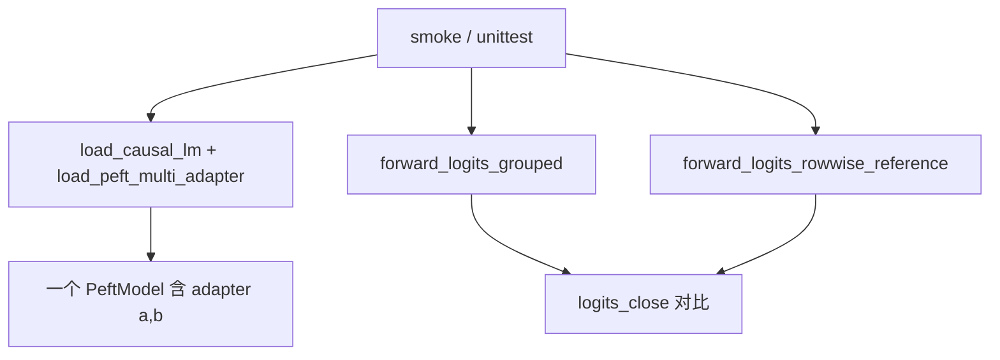

# multi_lora_phase2（第二步快照）

在 **phase1** 基础上增加：一个 `PeftModel` 挂多个 adapter，**同一 batch 内不同行用不同 LoRA**（分组子 batch forward）。

| 新增 | 说明 |
|------|------|
| `batching.py` | `forward_logits_grouped` / 逐行对照 |
| `examples/smoke_multi_lora_batch.py` | Qwen 上 grouped vs rowwise |
| `unittest/test_batching.py` | tiny-gpt2 分组 vs 逐行一致性 |

---

## 独立安装与运行

本目录是一个自包含的 Python 包（含 phase1 的 `hf_runner.py` 副本），**不依赖** `multi_lora_phase1/3` 与 `multi_lora/`，可单独安装运行。

### 1）环境要求

| 项 | 说明 |
|----|------|
| Python | ≥ 3.9 |
| 依赖 | `torch` / `transformers` / `peft` / `accelerate` / `pytest`（见 `requirements.txt`，本阶段无 triton） |
| GPU | 单测非必需（`sshleifer/tiny-gpt2`，CPU 可跑）；Qwen smoke 需要 GPU，bf16 全量约 16GB，`--low-vram` 压到 9GiB + CPU offload |
| 磁盘 / 网络 | 单测需下载 tiny-gpt2（数 MB）；smoke 需 Qwen2-7B-Instruct（约 15GB）+ 两个 LoRA |

### 2）安装

```bash
# 进入仓库根目录，即包含 multi_lora_phase2/ 的那一层
cd /path/to/multi_lora

python -m venv .venv-phase2
source .venv-phase2/bin/activate
pip install -U pip
pip install -r multi_lora_phase2/requirements.txt
```

对于torch，建议直接用镜像 `nvcr.io/nvidia/pytorch:25.04-py3`。

### 3）运行前置

包内均为绝对导入（`import multi_lora_phase2.xxx`），需把 **仓库根目录** 加入导入路径：

```bash
cd /path/to/multi_lora
export PYTHONPATH=$(pwd)

# 可选：模型缓存位置与下载加速
export HF_HOME=/data/hf
export HF_ENDPOINT=https://hf-mirror.com
```

### 4）跑单测（最快验证，CPU 即可）

```bash
python -m pytest multi_lora_phase2/unittest/test_batching.py -q
```

在 tiny-gpt2 上自造两个 LoRA，断言分组 forward 与逐行参考 `allclose`。

### 5）跑 Qwen smoke

```bash
# 分组 vs 逐行 logits 对比；--lora-ids 逐行指定 adapter，空串表示纯基座
python multi_lora_phase2/examples/smoke_multi_lora_batch.py --low-vram --gpu-id 0 --lora-ids "a,"

# 默认 6 行混合：a / 基座 / b / a / b / 基座
python multi_lora_phase2/examples/smoke_multi_lora_batch.py --low-vram --gpu-id 0

# 沿用 phase1 的串行单 adapter 冒烟
python multi_lora_phase2/examples/smoke_single_adapter.py --skip-base --low-vram --gpu-id 1
```

`smoke_multi_lora_batch.py` 常用参数：`--base-model`、`--adapter-a` / `--adapter-b`、`--names`（PEFT adapter 名，默认 `a,b`）、`--lora-ids`（逐行 adapter 名，长度须与 prompt 数一致）、`--rtol` / `--atol`（BF16 末 token logits 容差，默认 `2e-2` / `5e-1`）、`--low-vram`、`--gpu-id`、`--device`。

---

## 工作流总览



---

## 函数调用栈

### 1）Smoke：`examples/smoke_multi_lora_batch.py`

```
main()
├── load_tokenizer(base_model)
├── load_causal_lm(base_model)                    # 无 LoRA 的基座
├── load_peft_multi_adapter(base, {"a": path_a, "b": path_b}, first="a")
│   └── （见下方 多 adapter 加载栈）
├── tokenizer(texts, padding=True) → input_ids, attention_mask
├── forward_logits_grouped(model, input_ids, attention_mask, lora_ids)
│   └── （见下方 分组 logits 栈）
├── forward_logits_rowwise_reference(...)         # 逐行对照
└── logits_close(grouped, rowwise)
```

`lora_ids` 为 **PEFT adapter 名字符串**（如 `"a"`、`None` 表示基座），此时尚未使用 phase3 的 `lora_id`（uuid）。

---

### 2）多 adapter 加载栈：`batching.load_peft_multi_adapter`

```
load_peft_multi_adapter(base_model, adapters, first="a")
├── PeftModel.from_pretrained(base, adapters[first], adapter_name=first)
└── for name != first:
    └── model.load_adapter(adapters[name], adapter_name=name)
        └── 返回 PeftModel（set_adapter(name) 可切换）
```

---

### 3）核心：分组 logits `batching.forward_logits_grouped`

```
forward_logits_grouped(model, input_ids, attention_mask, lora_ids)
├── group_row_indices(lora_ids)
│   └── OrderedDict: adapter_key → [row indices]   # 如 "a"→[0,2], None→[1]
└── for (key, rows) in groups:
    ├── row_idx = tensor(rows)
    ├── sub_ids = input_ids.index_select(0, row_idx)
    ├── sub_mask = attention_mask.index_select(0, row_idx)   # 若有
    ├── [key is None] with model.disable_adapter():
    │       └── model(sub_ids, sub_mask, use_cache=False).logits
    ├── [else] model.set_adapter(key):
    │       └── model(sub_ids, sub_mask, use_cache=False).logits
    └── out_logits.index_copy_(0, row_idx, logits)           # 拼回 [B,T,V]
```

**语义**：逻辑上是一个 `[B, T]` batch；物理上按不同的 adapter 拆成若干子 batch 前向，再 scatter 回完整 logits。

---

### 4）逐行对照：`batching.forward_logits_rowwise_reference`

```
forward_logits_rowwise_reference(model, input_ids, attention_mask, lora_ids)
└── for i in range(B):
    ├── row_ids = input_ids[i:i+1]
    ├── key = lora_ids[i]
    ├── [None] disable_adapter → model(...).logits
    ├── [else] set_adapter(key) → model(...).logits
    └── pieces.append(logits)
└── torch.cat(pieces, dim=0)   # [B,T,V]
```

---

### 5）单测：`unittest/test_batching.py`

```
test_grouped_matches_rowwise
├── 本地 tiny-gpt2 + 两个 save_pretrained LoRA
├── load_peft_multi_adapter(...)
├── forward_logits_grouped(...)
├── forward_logits_rowwise_reference(...)
└── assert allclose
```

---

## 本阶段尚未出现

- `MultiLoRAManager`、`LoRARegistry`、`LoRAMemoryPool`
- GPU 槽位 / 驱逐 / `weight_indices`
- Triton / `forward_linear_with_pool_backend`

（以上在 phase3、phase4。）
