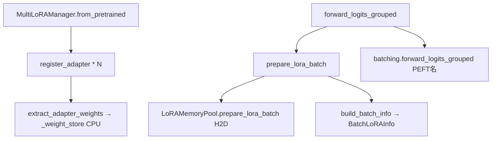

# multi_lora_phase3(第三步快照)

在 **phase2** 基础上增加;**Registry**(元数据 + 引用计数)、**CPU 权重库**、**GPU 显存池**(槽位 + LRU/FIFO 驱逐)、**MultiLoRAManager** 编排。

| 新增 | 说明 |
|------|------|
| `registry.py` / `eviction.py` | `LoRARef`、`acquire`/`release`、驱逐策略 |
| `weights.py` / `pool.py` | CPU 抽权重、GPU 槽位 H2D |
| `layers.py` | 朴素 `lora_delta`(单测/参考) |
| `manager.py` | `prepare_lora_batch` + 分组 PEFT forward |
| `examples/smoke_phase3_manager.py` | Qwen smoke |

---

## 独立安装与运行

本目录是一个自包含的 Python 包(含 phase1/2 的 `hf_runner.py`、`batching.py` 副本),**不依赖** `multi_lora_phase1/2` 与 `multi_lora/`,可单独安装运行。

### 1)环境要求

| 项 | 说明 |
|----|------|
| Python | ≥ 3.9 |
| 依赖 | `torch` / `transformers` / `peft` / `accelerate` / `pytest`(见 `requirements.txt`,本阶段无 triton) |
| GPU | 单测非必需(tiny-gpt2,CPU 可跑;GPU 池逻辑在 CPU 张量上同样成立);Qwen smoke 需 GPU,bf16 全量约 16GB,`--low-vram` 压到 9GiB + CPU offload |
| 磁盘 / 网络 | 单测需 tiny-gpt2(数 MB);smoke 需 Qwen2-7B-Instruct(约 15GB)+ 两个 LoRA |

### 2)安装

```bash
# 进入仓库根目录,即包含 multi_lora_phase3/ 的那一层
cd /path/to/multi_lora

python -m venv .venv-phase3
source .venv-phase3/bin/activate
pip install -U pip
pip install -r multi_lora_phase3/requirements.txt
```

装 torch 直接用镜像 `nvcr.io/nvidia/pytorch:25.04-py3`。

### 3)运行前置

包内均为绝对导入(`import multi_lora_phase3.xxx`),需把 **仓库根目录** 加入导入路径;

```bash
cd /path/to/multi_lora
export PYTHONPATH=$(pwd)

# 可选;模型缓存位置与下载加速
export HF_HOME=/data/hf
export HF_ENDPOINT=https://hf-mirror.com
```

### 4)跑单测(最快验证,CPU 即可)

```bash
python -m pytest multi_lora_phase3/unittest/ -q          # 全部四个测试
python -m pytest multi_lora_phase3/unittest/test_registry.py -q   # 注册/引用计数
python -m pytest multi_lora_phase3/unittest/test_pool.py -q       # 槽位分配与驱逐
python -m pytest multi_lora_phase3/unittest/test_manager_phase3.py -q  # manager vs 逐行参考
```

### 5)跑 Qwen smoke

```bash
# manager 主路径;prepare_lora_batch + 分组 forward,并触发一次驱逐
python multi_lora_phase3/examples/smoke_phase3_manager.py --low-vram --gpu-id 0

# 沿用 phase2 的分组 vs 逐行对比
python multi_lora_phase3/examples/smoke_multi_lora_batch.py --low-vram --gpu-id 0 --lora-ids "a,"

# 沿用 phase1 的串行单 adapter 冒烟
python multi_lora_phase3/examples/smoke_single_adapter.py --skip-base --low-vram --gpu-id 1
```

### 6)当库调用

```python
from multi_lora_phase3.manager import MultiLoRAManager

mgr = MultiLoRAManager.from_pretrained(base, {"a": path_a, "b": path_b}, max_loras_per_batch=2)
lora_ids = [mgr._peft_name_to_id["a"], None]     # None 表示该行走纯基座
logits, info = mgr.forward_logits_grouped(input_ids=..., attention_mask=..., lora_ids=lora_ids)
# info.weight_indices / info.lora_ranks / info.scalings 即 phase4 kernel 所需元数据
```

---

## 工作流总览

整模型 logits 仍走 **phase2 的 PEFT 分组 forward**;本阶段新增的是 **请求侧 `lora_id`(uuid)→ GPU pool 槽位** 的装载与元数据。



---

## 函数调用栈

### 1)初始化;`MultiLoRAManager.from_pretrained`

```
MultiLoRAManager.from_pretrained(base_model, adapters, ...)
├── load_peft_multi_adapter(base_model, adapters, first=...)    # phase2
├── MultiLoRAManager.__init__(peft_model, max_loras_per_batch, ...)
│   └── LoRAMemoryPool(...)                                     # 空槽位 K 个
└── for (peft_name, path) in adapters:
    └── register_adapter(LoRARef(lora_name=peft_name, ...), peft_adapter_name=peft_name)
        ├── registry.register(ref)                              # name → LoRARef(lora_id)
        ├── extract_adapter_weights(model, peft_adapter_name)   # weights.py
        │   ├── model.set_adapter(adapter_name)
        │   └── for LoraLayer in model.named_modules():
        │       └── modules[key] = (lora_A, lora_B) on CPU      # [r,in], [out,r]
        └── _weight_store[lora_id] = AdapterWeights
            _id_to_peft_name / _peft_name_to_id 互查
```

---

### 2)整模型前向(主路径);`manager.forward_logits_grouped`

```
forward_logits_grouped(input_ids, attention_mask, lora_ids)
│   lora_ids: List[Optional[str]]  # 每行的 **内部 lora_id (uuid)**,None=基座
│
├── prepare_lora_batch(lora_ids)
│   ├── validate_lora_batch(lora_ids)                           # distinct ≤ K
│   ├── [首次] _weight_store[None] = 空 AdapterWeights
│   └── pool.prepare_lora_batch(cur_uids, weight_store, lora_refs)
│       ├── eviction_policy.mark_used(uid)  # 每个 uid
│       └── for uid not resident:
│           ├── _alloc_slot(cur_uids, lora_refs)
│           │   ├── 有空槽 → 直接返回 slot_id
│           │   └── 无空槽 → eviction_policy.select_victim(...)
│           │       └── 踢掉 victim 的 uid 映射与 GPU 张量
│           └── _load_uid_to_slot(uid, buffer_id, weight_store)
│               └── CPU A/B → GPU slot tensors(按 max_lora_rank padding)
│   └── pool.build_batch_info(lora_ids)
│       └── BatchLoRAInfo(weight_indices, lora_ranks, scalings, evictions)
│
├── peft_keys = [peft_name_for_row(uid) for uid in lora_ids]    # uuid → "a"/"b"/None
└── batching.forward_logits_grouped(model, ..., lora_ids=peft_keys)   # phase2 栈
```

**注意**;phase3 的 **logits 仍由 HF PEFT 计算**;`prepare_lora_batch` 负责把权重放进 GPU 槽并产出 `BatchLoRAInfo`

---

### 3)GPU 池;`pool.LoRAMemoryPool`(单次 prepare 内部)

```
prepare_lora_batch(cur_uids, weight_store, lora_refs)
└── for uid in cur_uids:
    if uid not in uid_to_buffer_id:
        buffer_id = _alloc_slot(...)
        _load_uid_to_slot(uid, buffer_id, weight_store)
        uid_to_buffer_id[uid] = buffer_id

build_batch_info(lora_ids per row)
└── for each row uid:
    slot = get_buffer_id(uid)
    weight_indices[row] = slot
    lora_ranks[slot], scalings[slot] from _slot_meta[slot]
```

---

### 4)Smoke;`examples/smoke_phase3_manager.py`

```
main()
├── load_causal_lm + MultiLoRAManager.from_pretrained(...)
├── lora_ids = [mgr._peft_name_to_id["a"], None]
├── mgr.forward_logits_grouped(input_ids, attention_mask, lora_ids)
├── forward_logits_rowwise_reference(mgr.model, ..., lora_ids=peft_keys)
├── logits_close(...)
├── mgr.prepare_lora_batch([id_a, id_b])    # 触发可能的驱逐
└── mgr.prepare_lora_batch([id_a, None])
```

---

### 5)单测典型路径

| 测试文件 | 调用链要点 |
|----------|------------|
| `test_registry.py` | `LoRARegistry.register` / `acquire` / `release` / `unregister` |
| `test_pool.py` | `prepare_lora_batch` → 驱逐 → `get_slot_weights` |
| `test_manager_phase3.py` | `from_pretrained` → `forward_logits_grouped` vs rowwise |
| `test_batching.py` | 同 phase2(不经过 manager) |

`layers.lora_delta(x, A, B, scaling)` 仅在 pool 单测或手写参考里出现,不在 manager 主路径。

---

## 本阶段尚未出现

- `batch_info.LoRABatchInfo`(batch 描述)
- `backend/*`、`kernels/*`
- `forward_linear_with_pool_backend`(用 pool 算子层 LoRA delta)
- `inference_qwen7b_triton_linear.py`

(见 `multi_lora/` phase4。)
